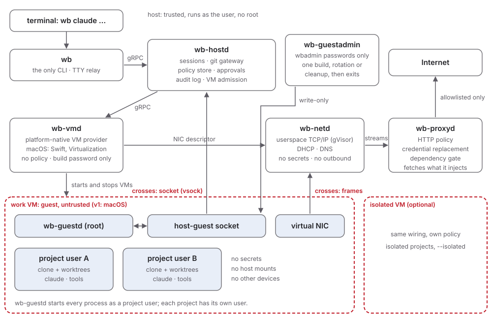

# S04 - Architecture

**Purpose:** Name the processes, the boundaries between them, and which
requirement each boundary serves.

**Requirements:** SEC01-separate-kernel, SEC02-no-host-fs-share,
SEC05-default-deny, SEC15-no-guest-disk-mount

**Tests:** C11-host-daemons, C01-network-and-dns

Briefs: B29-vsock-handoff, B34-sandboxed-daemons,
B48-process-supervision, B64-vmd-sandbox



## Overview

Exactly two channels cross the VM boundary: the **host-guest socket**
(vsock on macOS and Linux, Hyper-V sockets on Windows; terminated by
`wb-hostd`) and **Ethernet frames** (terminated by `wb-netd`). There is
no shared directory, no NAT to the host network, and no other device
that carries data (SEC01-separate-kernel, SEC02-no-host-fs-share, SEC05-default-deny).

### Pages

| Page | What it covers |
|---|---|
| S04-01-design-principles | The rules every process follows: one CLI, a Go core, an untrusted guest, policy checked twice, one work VM |
| S04-02-vm-provider | How `wb-vmd` hands over guest connections and the NIC, the fixed device set, and stream identity in `wb-proxyd` |
| S04-03-self-sandboxing | How each host daemon confines itself, and `wb-launcher` |
| S04-04-vm-processes | One `wb-vmd` per VM, `wb-vmd-install` and `wb-diskfmt` |
| S04-05-helper-programs | `wb-guestadmin`, `wb-release-check`, `wb-download` and `wb-build-ssh` |
| S04-06-git-confinement | The `wb-git` shim, the `wb-hostd` profile, and what `wb` takes from `wb-hostd` |
| S04-07-supervision | Who starts whom, when `wb-hostd` stops, upgrades and daemon restarts |
| S04-08-records-and-bounds | Accounting and event records, version skew, host work the guest can cause, logs |

## Processes

| Process | Lang | Runs as | Holds | Faces the guest via | Purpose |
|---|---|---|---|---|---|
| `wb` | Go | user, per invocation | nothing, and no store access; for `wb cred set` the value it reads, until it has written it to `wb-credset` (S15-least-privilege) | none | The only CLI: dispatcher for every command, TTY relay for agent sessions (S05-cli) |
| `wb-credset` | Go | user, one run per `wb cred set`, `rm` or `list`, started by `wb`, then exits | the `binding/*` secret store items it writes, deletes or lists, and nothing else | none | Confine itself, then do one store operation: write the value from its standard input, delete an item, or list item names (S15-least-privilege) |
| `wb-hostd` | Go | per-user service | policy, landing repos, state | host-guest socket | Sessions, git gateway, approvals, audit writer, admission control (S06-vm-lifecycle, S08-workspace-and-git, S09-policy-credentials-audit) |
| `wb-launcher` | Go, standard library only | user, started by `wb-hostd` before it confines itself (macOS only) | nothing | none | Start the programs in its fixed table when `wb-hostd` asks, so that each can confine itself (S04-03-self-sandboxing, "Each host daemon is self-sandboxed") |
| `wb-git` | Go | user, per git gateway transfer, started through `wb-launcher` (on macOS) (B34-sandboxed-daemons) | nothing | pack data from the guest, through `wb-hostd` | Confine itself to one repository (for a push, also reading the `export.git` it borrows from), then run `git receive-pack` or `git upload-pack` (S08-workspace-and-git) |
| `wb-prover` | Go | user, per boundary check (at `wb trust` and for an approval request whose result isn't cached), started through `wb-launcher` (on macOS); instance cap one per VM plus one for `wb trust` | nothing | repository policy, and a host name the guest asked for in an approval request, both through `wb-hostd` | Set its memory cap, confine itself to its inherited descriptors (the two documents and the result pipe), check the prover binary's hash, then run `openshell-prover check` with fixed arguments (S09-policy-credentials-audit) |
| `wb-vmd` | platform-native | user, one per VM, spawned for `wb-hostd` (through `wb-launcher` on macOS, as `wb-vmd-work`, `wb-vmd-isolated`, or `wb-vmd-install` for an image build) | its VM's handles; during an image build, the provisioning password on a pipe until the start call returns (S15-least-privilege) | none (devices only) | Create, start, stop, save, and restore its VM; hand guest socket connections and the NIC endpoint to other processes (S12-platforms) |
| `wb-netd` | Go | user, one per VM, spawned for `wb-hostd` (through `wb-launcher` on macOS) | nothing | Ethernet frames | Network stack, DHCP, DNS, stream hand-off (S07-egress-gateway) |
| `wb-proxyd` | Go | user, spawned for `wb-hostd` (through `wb-launcher` on macOS) | the binding secrets of the VM's sessions, fetched just in time, the CA key items, and the use of the CA signing key (S15-least-privilege) | streams from `wb-netd` | HTTP policy, credential replacement, dependency gate, upstream connections (S07-egress-gateway, S09-policy-credentials-audit) |
| `wb-guestadmin` | Go | user, one run per image build, `wbadmin` rotation or cleanup, started through `wb-launcher` (on macOS), then exits | the `wbadmin/*` secret store items it writes and fetches, and nothing else | one write-only host-guest connection to `wb-guestd`; pipes to the build's `wb-vmd` and `wb-build-ssh` | The admin side of the image build, `wbadmin` rotation at each VM's first contact, and removing the items of images and system disks that are gone (S15-least-privilege) |
| `wb-build-ssh` | Go | user, one per image build, started through `wb-launcher` (on macOS) | the build password on its standard input, for one session | one SSH session to the build guest, on the build VM's own network | Confine itself, then run the system `ssh` with compiled-in arguments and environment for the build's one install session (S15-least-privilege) |
| `wb-diskfmt` | Go | user, one run per new data disk, started through `wb-launcher` (on macOS) as `wb-diskfmt-work` or `wb-diskfmt-isolated`, then exits | nothing | none: it runs before any guest has run with the disk (SEC15-no-guest-disk-mount) | Confine itself to its VM's bundle, then create, attach, format and detach that VM's new data disk (S06-05-disks) |
| `wb-release-check` | Go | user, one run per image build, started through `wb-launcher` (on macOS); instance cap one per build, then exits | nothing | none: it reads bytes from `downloads.claude.ai` that `wb-download` fetched, on inherited descriptors | Confine itself to its inherited descriptors, check a Claude Code release's manifest signature, version, platform entry, size and SHA-256, and write the result to its pipe (S14-01-install) |
| `wb-download` | Go | user, one run per download for an image build, started through `wb-launcher` (on macOS); instance cap one per entry, then exits | nothing | none | Confine itself, then fetch over HTTPS, from the hosts compiled into its entry only, a macOS restore image or a Claude Code release into files `wb-hostd` opened for it (S17-03-downloads) |
| `wb-askpass` | Go | user, started by `ssh` for the login prompt | one line of `ssh`'s standard input, until it prints it | none | Print the first line of its standard input to `ssh` (S15-least-privilege) |
| `wb-guestd` | Go | root / SYSTEM inside the guest | nothing | n/a (runs in the guest) | Users, PTY exec, git transport (S06-vm-lifecycle) |

Native user-interface helpers (notifications with actions, later a tray
or menu-bar item) are separate small processes per platform. They render
approval requests and return the user's answer to `wb-hostd`, and decide
nothing themselves (S12-platforms).

## Host state

Locations follow each OS's conventions (paths in S12-platforms); the logical
layout is the same everywhere:

```
<config>/                             user-editable configuration (S09-policy-credentials-audit)
  config.toml                         global settings and defaults
  policy.yaml                         global network policy (S09-policy-credentials-audit)
  projects/<project-id>.toml          per-project settings, toolchain manifest reference
  projects/<project-id>.policy.yaml   per-project network policy
<data>/
  images/                             base images (copy-on-write clones)
  images/macos-restore.ipsw           the restore image a macOS image build installs from, fetched by wb-download (S17-install-and-upgrade)
  images/macos-restore.ipsw.partial   the restore image while it downloads
  downloads/                          a Claude Code release during an image build (S14-claude-in-guest)
  images/macos-build.noindex/         the build VM's bundle, new for each image build, never listed as an image (S06-vm-lifecycle)
  vms/<guest-os>-{work,isolated}.noindex/  VM bundles: disks, machine identity, saved state
  projects/<project-id>/export.git    bare repo the guest fetches from: selected refs only, written only by wb (S08-workspace-and-git)
  projects/<project-id>/landing.git   bare repo receiving session branches (S08-workspace-and-git)
  state.db                            SQLite: the last VM generation of each slot (S04-02-vm-provider), projects, sessions, approvals, caches, the Go clock's point and tree heads (S07-egress-gateway), each VM's placeholder set until the VM is deleted (S09-policy-credentials-audit), each VM's CA records, the removal list of CA keys, on Linux whether the CA key is in a TPM (S09-policy-credentials-audit, S15-least-privilege), and the catalog entry of the restore image (S17-install-and-upgrade). Migrated by wb-hostd only, with its backups next to it as state.db.v<N>.bak (S17-install-and-upgrade). Mode 600
  run/                                user-only directory for local IPC endpoints
<logs>/                               audit JSONL, and one log per host process, <process>.log and its rotated files, all written by wb-hostd (S04-08-records-and-bounds)
```

## Inter-process contracts

Every message between processes is protobuf. A request with a reply
goes over gRPC. On the host it runs over a local IPC endpoint only the
user can open: Unix sockets in a `0700` directory on macOS and Linux,
named pipes with an ACL for the user's SID on Windows. The peer's
identity is checked on every connection. To the guest it runs over the
host-guest socket.

gRPC can't pass a descriptor. So a hand-off of descriptors is one
record per message on a socketpair inherited at spawn
(S04-02-vm-provider, "Hand-off on macOS").

The `.proto` files in `proto/` are the one contract for every language
(S10-tech-stack):

| File | Package | Holds |
|---|---|---|
| `proto/wraithbox/vmd/v1/vmd.proto` | `wraithbox.vmd.v1` | `VMService`, served by `wb-vmd` and called by `wb-hostd`, and `HandoffMessage`, the record of the hand-off channel |
| `proto/wraithbox/guest/v1/guest.proto` | `wraithbox.guest.v1` | `GuestService`, served by `wb-guestd` and called by `wb-hostd` |

A refusal over gRPC names its rule in a `google.rpc.ErrorInfo` detail,
as the `reason`, so the caller needn't parse the message text. The
comments on each message from the guest, and on `HandoffMessage`, state
the bounds the receiver checks.

### The version record

On a host stream connection, gRPC included, each side sends its version
record first, then reads the peer's (S04-08-records-and-bounds,
"Between host processes"). Go and Swift write the same bytes:

- the four bytes `WBV1`;
- one length byte;
- that many bytes of the build version, 1 to 64 bytes, each from 0x20
  to 0x7E. A length of 0 is an unstamped build, which has no version.

The reader takes at most 69 bytes, under a deadline of a few seconds
(the value is in code). Until the peer's record has passed, it hands
nothing the peer sent to gRPC, and sends the peer nothing but its own
record. Each refusal closes the connection and logs both versions, with
its rule:

| Rule | When |
|---|---|
| `peer-version-timeout` | no whole record before the deadline |
| `peer-version-malformed` | another magic, a length over 64, or a version byte outside 0x20 to 0x7E |
| `peer-version-unstamped` | the peer's version or its own is empty |
| `peer-version-mismatch` | the versions differ as bytes |

**Status:** Draft
